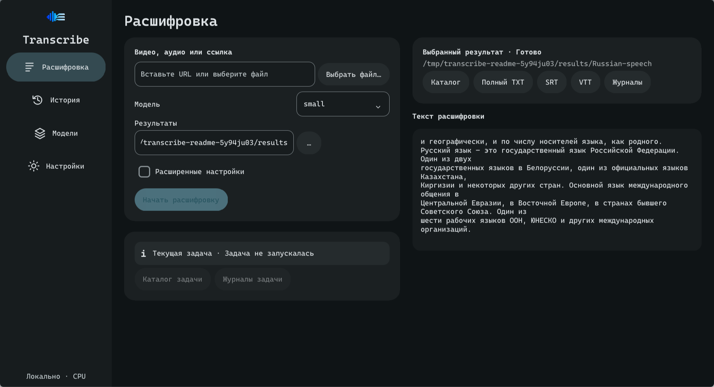
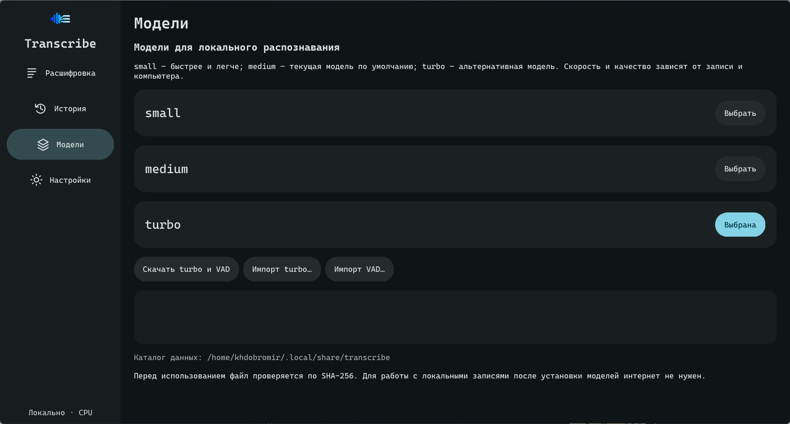
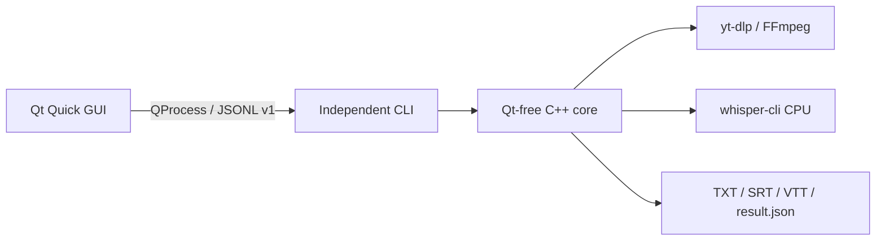

<p align="center"></p>

<h1 align="center">Transcribe</h1>

<p align="center"><a href="README.md">Русский</a> · <strong>English</strong></p>

Transcribe recognizes Russian speech in audio, video and lectures locally on your **CPU**, on Linux and Windows.
The desktop GUI and independent CLI save text and subtitles as **TXT, SRT and VTT**.

[Download](#download-and-requirements) · [GUI quick start](#gui-quick-start) · [CLI](#cli-quick-start)
· [Documentation](docs/README.md) · [Changelog](CHANGELOG.md) · [Development](#development)

## Demo



A completed result from a public 30-second recording, displayed in the v0.5.0 GUI.
[Source recording, parameters and full TXT/SRT/VTT](docs/assets/demo/README.md).
This demonstrates the application; speed and accuracy will vary with other recordings.

<details>
<summary>Model selection, download and import</summary>



Models are downloaded separately and verified with SHA-256.
</details>

An excerpt from the actual exports of this recording:

```text
и географически, и по числу носителей языка, как родного.
Русский язык – это государственный язык Российской Федерации. Один из двух
```

```srt
1
00:00:00,000 --> 00:00:03,900
 и географически, и по числу носителей языка, как родного.
```

## Download and requirements

Stable release: [v0.5.0](https://github.com/khdobromir/transcriber/releases/tag/v0.5.0).

| Package | Supported platform | Launch |
| --- | --- | --- |
| [Linux AppImage](https://github.com/khdobromir/transcriber/releases/download/v0.5.0/Transcribe-0.5.0-linux-x86_64.AppImage) | x86_64, glibc 2.39+ | Make the file executable and open it |
| [Windows ZIP](https://github.com/khdobromir/transcriber/releases/download/v0.5.0/Transcribe-0.5.0-windows-x64.zip) | Windows 11 x64 | Extract the whole ZIP and run `bin\transcribe-gui.exe` |

Qt, CPU Whisper, FFmpeg and standalone yt-dlp are bundled; no separate Python,
Qt SDK or compiler is needed to run the packages. **Recognition models and Silero VAD are separate downloads.**
GPU acceleration, macOS, ARM and musl/Alpine are outside these packages' supported targets.

Before launch, [compare SHA-256 with the asset digest on GitHub Releases](docs/user/quick-start.md#verify-and-launch).
That guide also covers running an AppImage without FUSE. Source and build-input archives are for developers.

## GUI quick start

1. Download the package for your OS, verify SHA-256 and launch the application.
2. On **Transcription**, select `small` for an initial test.
3. Open **Models**, choose **Download small and VAD** and wait for successful verification.
   For offline use, import both files from the [model manifest](scripts/models.tsv) beforehand.
4. On **Transcription**, choose your local recording and an output directory.
   Keep one chunk and automatic threads, then select **Start transcription**.
5. Wait for **Completed**, then open **Directory** or **Full TXT**.
   Each run has its own directory with `transcripts/transcript.txt`, `.srt`, `.vtt`, `logs/` and `result.json`.

A fresh GUI defaults to `medium`; switch to `small` for the first test.
Preview text and 100% progress alone do not confirm that all exports are saved.
[Detailed quick start](docs/user/quick-start.md) · [User guide](docs/user/guide.md).

## CLI quick start

**Linux:** install the CLI separately from source. First prepare the
[installer prerequisites](docs/build/from-source.md#linux-cli-source-installer), then run as a regular user:

```sh
git clone --branch v0.5.0 --depth 1 https://github.com/khdobromir/transcriber.git
cd transcriber
bash install.sh small
export PATH="$HOME/.local/bin:$PATH"
transcribe --model small --out "results" "lecture.wav"
```

The AppImage launches the GUI and does not install a `transcribe` command in PATH.

**Windows:** prepare the model and VAD in the GUI, then open PowerShell at the root of the extracted ZIP:

```powershell
.\bin\transcribe.exe --model small --out "results" "C:\Recordings\lecture.wav"
```

Replace the input path with your recording. A new run directory under `results/` contains
`transcripts/transcript.txt`, `.srt`, `.vtt`, logs and `result.json`.
The CLI reports stages and file locations; recognized text is saved to TXT.
[All CLI options](docs/user/cli.md) · [Recorded version and help output](docs/assets/cli-session.txt).

## Features

- **Sources:** local audio/video and one URL supported by yt-dlp.
- **Models:** `small`, `medium`, `turbo`; SHA-256 verified download/import, Silero VAD.
- **Recognition:** live partial text, progress, approximate ETA, cancellation; CPU threads, chunks and workers.
- **Export:** TXT, SRT, VTT and a separate result directory for each run.
- **GUI:** history, Russian and English languages, preserved reading position; Material You / Material 3,
  light/dark themes, wallpaper or image palettes and reduced motion.

## Local processing and data

| Operation or data | Behavior |
| --- | --- |
| Recognition | Recordings are processed locally through whisper.cpp on CPU |
| Model and URL downloads | Require network access; models come from manifest sources, media through yt-dlp |
| Cookies | Used by yt-dlp to access the selected source; the GUI does not save them in settings |
| Media cache | Downloaded media stays local; default limit is 10 GiB, and caching can be disabled |
| Results and logs | Saved locally; text, URLs and paths can contain personal information |

After model preparation, local-file recognition works offline.
Models, settings, history and results are stored separately from the replaceable application.
[Data paths and upgrades](docs/user/guide.md#data-and-upgrades).

## FAQ

**Which languages are recognized?** Russian. The GUI can switch between Russian and English;
this does not change recognition. CLI console help remains Russian.

**Is an internet connection required?** For model and URL downloads. Prepared models and a local recording
allow offline use; import the recognition model and VAD before an offline first run.

**How fast is it, and how much RAM is needed?** This depends on CPU, model, recording and parallelism.
`medium` may run slower than real time; each extra worker loads its own model.
ETA is approximate, and names, terms and formulas in the transcript need review.

**Which model should I use, and what is VAD?** Start with `small`; `medium` and `turbo` offer other
resource/quality tradeoffs on your recording. VAD detects speech regions, is enabled by default
and needs a separate file. See [model preparation](docs/user/guide.md#inputs-and-models).

**What happens on cancellation and retry?** **Cancel** or CLI Ctrl+C preserves partial text
already published. Retry starts recognition again. SRT/VTT are ready after successful export.

**Which platforms are supported?** Packages target Linux x86_64/glibc 2.39+ and Windows 11 x64.
For startup, model or download problems, see [troubleshooting](docs/troubleshooting.md).

## How it works



The GUI presents the task and manages models and history. A separate backend process
runs recognition and supervises external tools.
[Architecture and decisions](docs/architecture/overview.md) · [JSONL v1](docs/architecture/protocol-v1.md).

## Development

**C++23 · Qt Quick / QML · CMake.** See [builds and prerequisites](docs/build/from-source.md),
the [source map](docs/developer/getting-started.md), [testing](docs/testing/README.md)
and [CONTRIBUTING.md](CONTRIBUTING.md) for the development environment and checks.
The [v0.5.0 notes](docs/releases/v0.5.0/notes.md) and [verification evidence](docs/releases/v0.5.0/validation.md)
cover the release; [historical measurements](docs/benchmarks/README.md) are not a WER study.

For bug reports include the version, OS, installation route and a minimal example.
Use the [private reporting route](SECURITY.md) for vulnerabilities.

## License

Transcribe code is [MIT](LICENSE). Whisper/whisper.cpp develop the ASR engine and models;
Transcribe provides native integration and the application. Libraries, tools,
models and the demo recording retain their own terms:
[THIRD_PARTY.md](THIRD_PARTY.md) · [demo attribution](docs/assets/demo/README.md).
