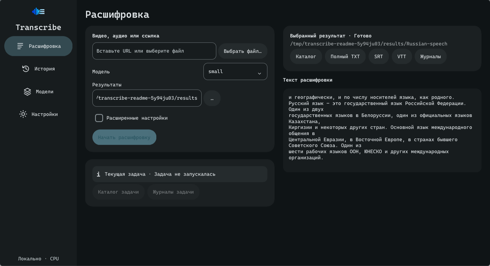
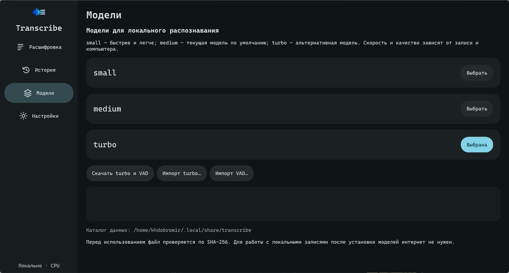
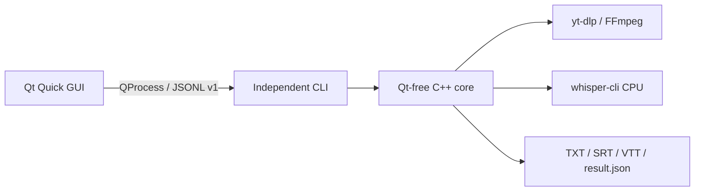

<p align="center"></p>

<h1 align="center">Transcribe</h1>

<p align="center"><strong>Русский</strong> · <a href="README.en.md">English</a></p>

Программа для локального распознования русской речи в аудио и видео файлах на **CPU**. Поддерживаемые платформы: Linux и Windows. Доступны GUI и CLI. Результат предоставляется в форматах **TXT, SRT и VTT**.

[Скачать](#загрузка-и-требования) · [Старт GUI](#быстрый-старт-gui) · [CLI](#быстрый-старт-cli)
· [Документация](docs/README.md) · [Изменения](CHANGELOG.md) · [Разработка](#разработка)

## Демонстрация



Готовый результат публичной 30-секундной записи в GUI v0.5.0.
[Исходная запись, параметры и полные TXT/SRT/VTT](docs/assets/demo/README.md).
Это пример работы приложения; скорость и точность на других записях будут отличаться.

<details>
<summary>Выбор модели, загрузка и импорт</summary>



Модели скачиваются отдельно от приложения и проверяются по SHA-256.
</details>

Фрагмент настоящего экспорта этой записи:

```text
и географически, и по числу носителей языка, как родного.
Русский язык – это государственный язык Российской Федерации. Один из двух
```

```srt
1
00:00:00,000 --> 00:00:03,900
 и географически, и по числу носителей языка, как родного.
```

## Загрузка и требования

Стабильный выпуск: [v0.5.0](https://github.com/khdobromir/transcriber/releases/tag/v0.5.0).

| Пакет | Поддерживаемая платформа | Запуск |
| --- | --- | --- |
| [Linux AppImage](https://github.com/khdobromir/transcriber/releases/download/v0.5.0/Transcribe-0.5.0-linux-x86_64.AppImage) | x86_64, glibc 2.39+ | Разрешить запуск файла и открыть его |
| [Windows ZIP](https://github.com/khdobromir/transcriber/releases/download/v0.5.0/Transcribe-0.5.0-windows-x64.zip) | Windows 11 x64 | Распаковать весь ZIP и запустить `bin\transcribe-gui.exe` |

Qt, CPU Whisper, FFmpeg и standalone yt-dlp включены в пакеты; отдельные Python,
Qt SDK и компилятор для запуска не нужны. **Модели распознавания и Silero VAD скачиваются отдельно.**
GPU, macOS, ARM и musl/Alpine не входят в поддержку этих пакетов.

Перед запуском [сверьте SHA-256 с digest файла в GitHub Releases](docs/user/ru/quick-start.md#проверка-и-запуск).
Там же описан запуск AppImage без FUSE. Исходники и build-inputs нужны разработчикам.

## Установка и работа с GUI

1. Скачайте пакет для своей ОС, проверьте SHA-256 и запустите приложение.
2. На странице **Расшифровка** выберите `small` для первого теста.
3. Откройте **Модели**, нажмите **Скачать small и VAD** и дождитесь успешной проверки.
   Для работы без сети заранее импортируйте оба файла из [манифеста моделей](scripts/models.tsv).
4. На странице **Расшифровка** выберите свою локальную запись и каталог результатов.
   Оставьте одну часть и автоматические потоки, затем нажмите **Начать расшифровку**.
5. Дождитесь статуса **Готово** и откройте **Каталог** или **Полный TXT**.
   В отдельном каталоге запуска находятся `transcripts/transcript.txt`, `.srt`, `.vtt`, `logs/` и `result.json`.

Модель по умолчанию - `medium`; для первого теста переключите его на `small`.
Предпросмотр и 100% прогресса ещё не подтверждают сохранение всех результатов.
[Подробный быстрый старт](docs/user/ru/quick-start.md) · [Руководство пользователя](docs/user/ru/guide.md).

## Установка и работа с CLI

**Linux:** CLI устанавливается отдельно из исходников. Сначала подготовьте
[зависимости установщика](docs/build/from-source.md#linux-cli-source-installer), затем выполните следующие команды:

```sh
git clone --branch v0.5.0 --depth 1 https://github.com/khdobromir/transcriber.git
cd transcriber
bash install.sh small
export PATH="$HOME/.local/bin:$PATH"
transcribe --model small --out "results" "lecture.wav"
```

**Windows:** после подготовки модели и VAD в GUI откройте PowerShell в корне распакованного ZIP:

```powershell
.\bin\transcribe.exe --model small --out "results" "C:\Recordings\lecture.wav"
```

Замените путь своей записью. В `results/` появится отдельный каталог запуска с
`transcripts/transcript.txt`, `.srt`, `.vtt`, журналами и `result.json`.
CLI сообщает этапы и расположение файлов; сам текст распознавания сохраняется в TXT.
[Все параметры CLI](docs/user/cli.md) · [Записанный вывод версии и справки](docs/assets/cli-session.txt).

## Возможности

- **Источники:** распознование локальных аудио/видео или скачивание и последующее распознование по URL (через yt-dlp).
- **Модели:** загрузка и импорт моделей `small`, `medium`, `turbo` с проверкой SHA-256, а также Silero VAD.
- **Распознавание:** промежуточный результат распознования, прогресс, приблизительная ETA, отмена; настройка потоков, частей и работников.
- **Экспорт:** TXT, SRT, VTT и отдельный каталог результатов каждого запуска.
- **GUI:** история распознований, русский и английский языки, сохранение места чтения при остановке распознования; Material You / Material 3,
  светлая/тёмная тема, палитра из обоев или картинки и уменьшение анимаций.

## Локальность и данные

| Операция или данные | Что происходит |
| --- | --- |
| Распознавание | Запись обрабатывается локально через whisper.cpp на CPU |
| Загрузка моделей и URL | Нужна сеть; модели загружаются из источников манифеста, медиа — через yt-dlp |
| Cookies | Используются yt-dlp для доступа к выбранному источнику; GUI не сохраняет их в настройках |
| Медиакэш | Скачанное медиа хранится локально; лимит по умолчанию 10 ГиБ, кэш можно отключить |
| Результаты и журналы | Сохраняются локально; текст, URL и пути могут содержать личные данные |

После подготовки моделей локальное распознавание работает без интернета.
Модели, настройки, история и результаты хранятся отдельно от заменяемого приложения.
[Пути данных и обновление](docs/user/ru/guide.md#данные-и-обновление).

## Частые вопросы

**Какие языки распознаются?** Русский. Язык GUI можно переключать между русским и английским;
это не меняет язык распознавания. Консольная справка CLI остаётся русской.

**Нужен ли интернет?** Для скачивания моделей и медиа по URL. Подготовленные модели и локальная запись
позволяют работать без сети; для первого запуска без интернета импортируйте модель и VAD заранее.

**Каковы скорость и расход памяти?** Они зависят от CPU, модели, записи и параллелизма.
`medium` может работать медленнее реального времени; каждый дополнительный работник загружает свою модель.
ETA приблизительна, а имена, термины и формулы в расшифровке требуют проверки.

**Какую модель выбрать и зачем VAD?** Начните с `small`; `medium` и `turbo` — другие варианты
с иными требованиями и качеством на вашей записи. VAD определяет участки речи, включён по умолчанию
и требует отдельного файла. [Подготовка моделей](docs/user/ru/guide.md).

**Что происходит при отмене и повторе?** Кнопка **Отменить** или Ctrl+C в CLI сохраняют уже
опубликованный частичный текст. Повтор запускает распознавание заново. SRT/VTT готовы после успешного экспорта.

**Какие платформы поддерживаются?** Пакеты предназначены для Linux x86_64/glibc 2.39+ и Windows 11 x64.
При проблемах с запуском, моделями или загрузкой см. [устранение неполадок](docs/troubleshooting.md).

## Как это устроено



GUI отображает задачу и управляет моделями и историей. Отдельный backend-процесс
выполняет распознавание и управляет внешними инструментами.
[Архитектура и решения](docs/architecture/overview.md) · [JSONL v1](docs/architecture/protocol-v1.md).

## Разработка

**C++23 · Qt Quick / QML · CMake.** [Сборка и зависимости](docs/build/from-source.md),
[карта исходников](docs/developer/getting-started.md), [тестирование](docs/testing/README.md)
и [CONTRIBUTING.md](CONTRIBUTING.md) описывают рабочее окружение и проверки.
[Описание v0.5.0](docs/releases/v0.5.0/notes.md) и [свидетельства проверок](docs/releases/v0.5.0/validation.md)
содержат подробности выпуска; [исторические измерения](docs/benchmarks/README.md) не являются оценкой WER.

При сообщении об ошибке укажите версию, ОС, способ установки и минимальный пример.
Для уязвимостей используйте [конфиденциальный канал](SECURITY.md).

## Лицензия

Код Transcribe — [MIT](LICENSE). Whisper/whisper.cpp разрабатывают ASR и модели;
Transcribe обеспечивает нативную интеграцию и приложение. Библиотеки, инструменты,
модели и демонстрационная запись сохраняют собственные условия:
[THIRD_PARTY.md](THIRD_PARTY.md) · [атрибуция примера](docs/assets/demo/README.md).
